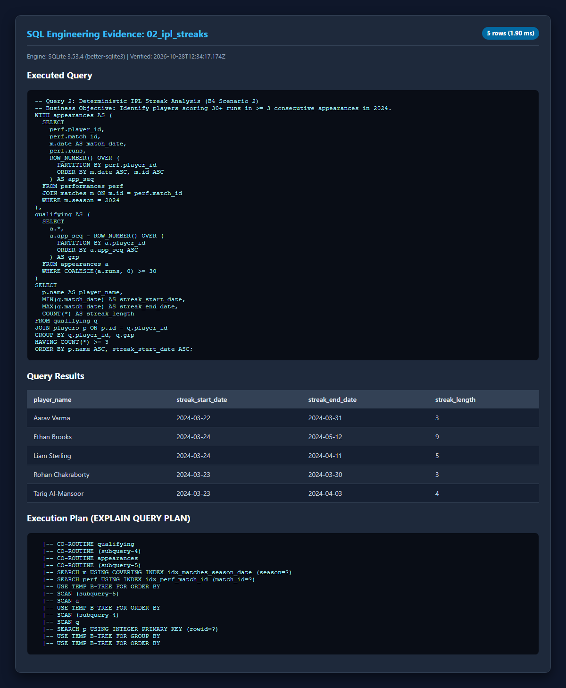
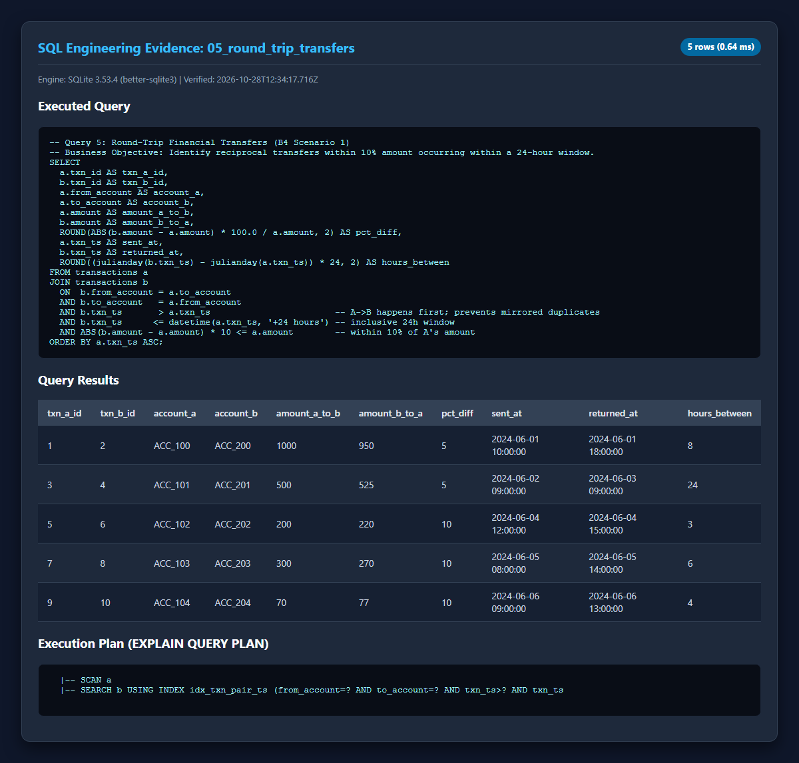
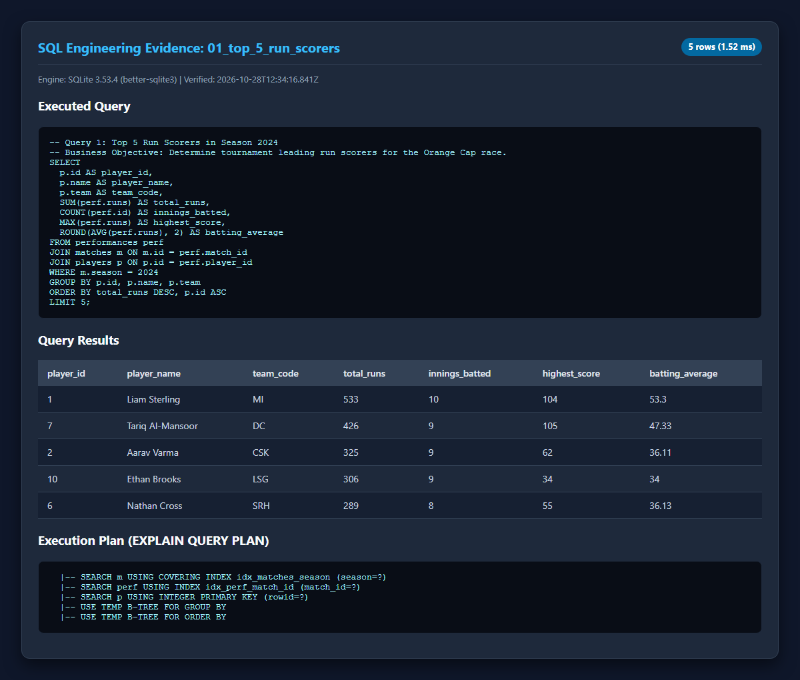
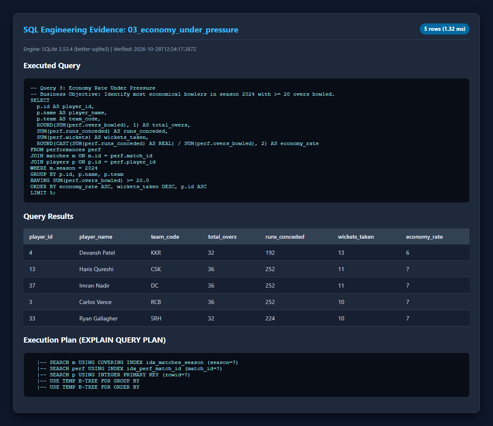
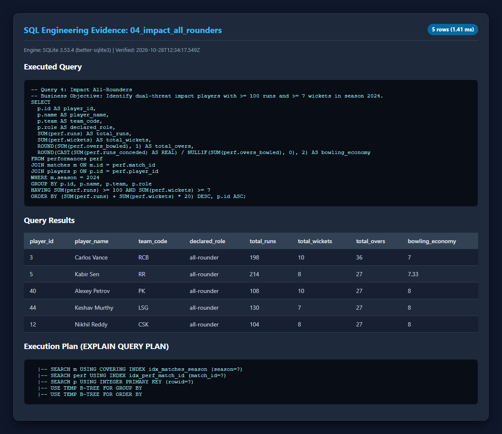
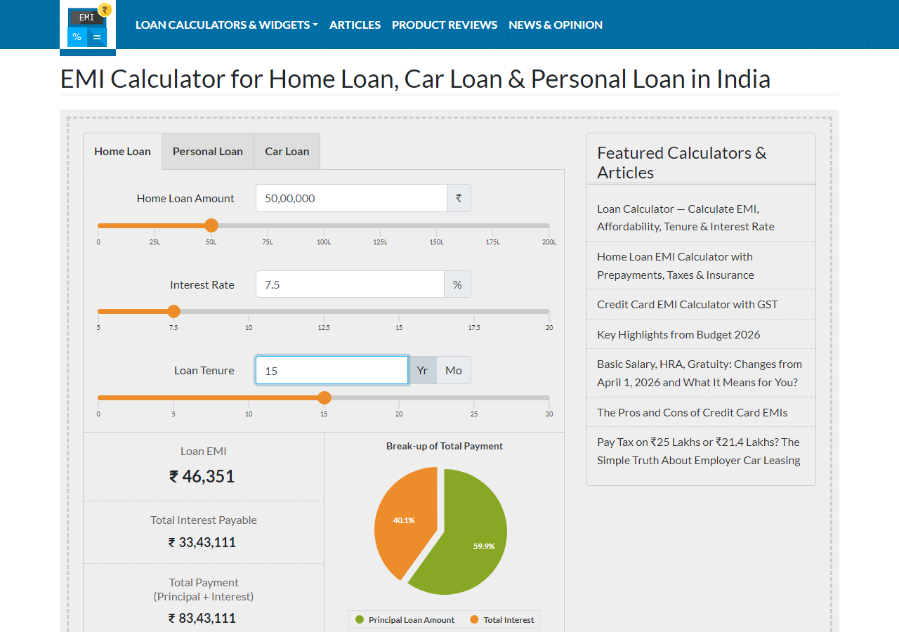
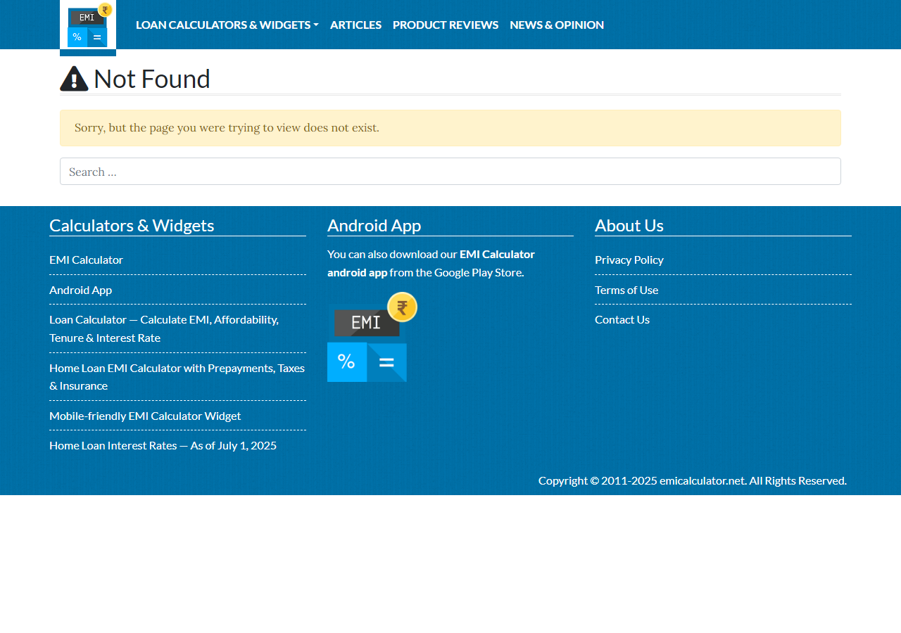
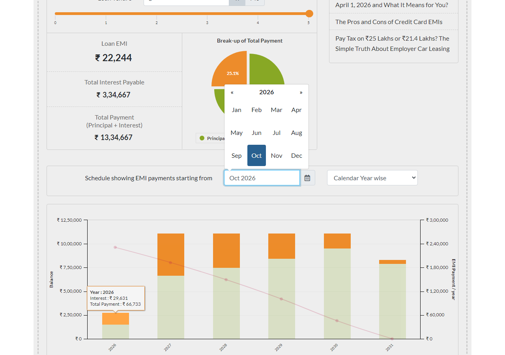

# Streamhub QA Automation Assessment (Section B)

Production-grade test automation and engineering submission for **Section B** of the Streamhub Fullstack + QA Automation Assessment, covering API Development, Playwright + Cucumber API & UI Automation, SQL Engineering, and AI Self-Healing Locators.

---

## 1. How to Run the Program

### Prerequisites

- **Node.js**: `>= 22.0.0` LTS (Node 22 LTS or Node 24 verified)
- **Package Manager**: `npm` (`>= 10.0.0`)
- **Browser Engine**: Playwright Chromium

### Setup Instructions

```bash
# 1. Clone the repository
git clone <YOUR_REPOSITORY_URL>
cd job-assignment

# 2. Install pinned dependencies
npm ci

# 3. Install Playwright Chromium browser binary
npx playwright install chromium

# 4. Create local environment configuration from template
# Windows:
copy .env.example .env

# 5. Seed the SQLite database with the synthetic dataset
npm run db:seed
```

### Quick Verification (Run Entire Suite)

```bash
# Run code quality gates
npm run lint
npm run typecheck

# Run full API and SQL test suite
npm run test:api
npm run test:sql

# Run live UI test suite (emicalculator.net)
npm run test:ui

# Verify submission compliance
npm run audit
```

---

## 2. Complete List of Commands

| Command                                 | Description                                                                                                                                                                                 |
| :-------------------------------------- | :------------------------------------------------------------------------------------------------------------------------------------------------------------------------------------------ |
| **API & Database**                      |                                                                                                                                                                                             |
| `npm run api:start`                     | Boot the Express REST API server on `http://localhost:3100` (in-memory indexed).                                                                                                            |
| `npm run api:dev`                       | Start the Express REST API in watch mode with automatic reload on changes.                                                                                                                  |
| `npm run data:verify`                   | Run static verification gate asserting 2,184 dataset integrity & schema invariants.                                                                                                         |
| `npm run db:seed`                       | Seed SQLite database (`data/streamhub.db`) with 10 teams, 50 players, 46 matches, 450 performances, and 17 transactions in <30ms.                                                           |
| **SQL Engineering**                     |                                                                                                                                                                                             |
| `npm run sql:run`                       | Execute all 7 analytical SQL queries, print result tables to the terminal, save text query plans to `sql/output/`, and capture PNG screenshots to `sql/screenshots/`.                       |
| `npm run sql:verify`                    | Cross-validate SQLite query results against in-memory API repository calculations (100% agreement gate).                                                                                    |
| `npm run test:sql`                      | Run Cucumber BDD scenarios for SQL tests (Round-Trip Transfers & IPL Streaks) and print result tables to console.                                                                           |
| **Test Suites (Cucumber + Playwright)** |                                                                                                                                                                                             |
| `npm run test:smoke`                    | Run framework smoke test verifying server liveness and basic API retrieval.                                                                                                                 |
| `npm run test:api`                      | Run full API BDD test suite: **85 scenarios, 410 steps** covering full CRUD, query filters, search, sorting, and error envelopes.                                                           |
| `npm run test:ui`                       | Run live UI automation suite on `emicalculator.net`: **4 scenarios, 40 steps** (Home Loan pie chart & Personal Loan bar chart).                                                             |
| `npm run test:self-heal`                | Run the 5 intentionally broken locators to demonstrate self-healing failure capture.                                                                                                        |
| `npm run test:all`                      | Run all active test suites (API + UI + SQL).                                                                                                                                                |
| `npm run heal`                          | Run AI self-healing CLI engine POC (`--provider mock`, `--provider gemini`, or `--provider anthropic`) to generate diff proposals.                                                          |
| `npm run report`                        | Ingest Cucumber JSON outputs and compile consolidated HTML dashboard into `reports/html/index.html`.                                                                                        |
| **Quality & Compliance**                |                                                                                                                                                                                             |
| `npm run lint`                          | Run ESLint with zero-warning threshold (`--max-warnings=0`).                                                                                                                                |
| `npm run lint:fix`                      | Automatically fix ESLint linting issues.                                                                                                                                                    |
| `npm run typecheck`                     | Run strict TypeScript compiler verification (`tsc --noEmit`).                                                                                                                               |
| `npm run format`                        | Format all codebase files with Prettier.                                                                                                                                                    |
| `npm run format:check`                  | Verify codebase formatting against Prettier rules.                                                                                                                                          |
| `npm run audit`                         | Run release compliance script validating all 6 quality gates (TODO traceability, zero hardcoded URLs, zero brittle locators, broken locators count, deliverable existence, lint/typecheck). |
| `npm run clean`                         | Remove temporary build files, test results, traces, and compiler caches.                                                                                                                    |

---

## 3. API Routes & Endpoints

The API runs at `http://localhost:3100` and serves the synthetic dataset entirely from pre-indexed in-memory data structures ($O(1)$ lookups, zero disk I/O per request).

### Endpoint Summary

| Method   | Route                           | Description                                   | Supported Query / Body Parameters                                                                | Status Codes               |
| :------- | :------------------------------ | :-------------------------------------------- | :----------------------------------------------------------------------------------------------- | :------------------------- |
| `GET`    | `/health`                       | Server health and liveness check              | _None_                                                                                           | `200`                      |
| `GET`    | `/api/players`                  | List and search players                       | `team`, `role`, `q` (name search), `min_runs`, `sort_by`, `order`, `page`, `limit`               | `200`, `400`               |
| `GET`    | `/api/players/:id`              | Get single player by ID                       | _None_                                                                                           | `200`, `400`, `404`        |
| `POST`   | `/api/players`                  | Create new player entity                      | JSON Body: `name`, `team`, `role`, `isOverseas`, `total_runs`, `total_wickets`, `matches_played` | `201`, `400`, `422`        |
| `PUT`    | `/api/players/:id`              | Update existing player entity                 | JSON Body: Partial player fields                                                                 | `200`, `400`, `404`, `422` |
| `DELETE` | `/api/players/:id`              | Delete player by ID                           | _None_                                                                                           | `200`, `404`               |
| `GET`    | `/api/matches`                  | List match fixtures                           | `team`, `venue`, `date_from`, `date_to`, `sort_by`, `order`, `page`, `limit`                     | `200`, `400`, `422`        |
| `GET`    | `/api/matches/:id`              | Get single match by ID                        | _None_                                                                                           | `200`, `400`, `404`        |
| `GET`    | `/api/performances`             | List individual match performances            | `player_id`, `match_id`, `min_runs`, `sort_by`, `order`, `page`, `limit`                         | `200`, `400`               |
| `GET`    | `/api/performances/:id`         | Get single performance by ID                  | _None_                                                                                           | `200`, `400`, `404`        |
| `GET`    | `/api/players/:id/performances` | Match performances for player                 | `min_runs`, `sort_by`, `order`, `page`, `limit`                                                  | `200`, `400`, `404`        |
| `GET`    | `/api/streaks`                  | Analytical 30+ runs consecutive match streaks | `min_matches`, `min_runs`, `season`                                                              | `200`, `400`               |

### Sample Request & Response Payloads

#### `POST /api/players`

**Request:**

```bash
curl -X POST http://localhost:3100/api/players \
  -H "Content-Type: application/json" \
  -d '{
    "name": "Rohan Verma",
    "team": "MI",
    "role": "batter",
    "isOverseas": false,
    "total_runs": 450,
    "total_wickets": 0,
    "matches_played": 12
  }'
```

**Response (`201 Created`):**

```json
{
  "success": true,
  "data": {
    "id": 51,
    "name": "Rohan Verma",
    "team": "MI",
    "role": "batter",
    "isOverseas": false,
    "total_runs": 450,
    "total_wickets": 0,
    "matches_played": 12
  }
}
```

#### `GET /api/streaks?min_matches=3&min_runs=30`

**Response (`200 OK`):**

```json
{
  "success": true,
  "count": 5,
  "data": [
    {
      "player_id": 2,
      "player_name": "Aarav Varma",
      "streak_start_date": "2024-03-22",
      "streak_end_date": "2024-03-31",
      "streak_length": 3,
      "match_ids": [1, 7, 12],
      "runs": [54, 62, 58]
    },
    {
      "player_id": 10,
      "player_name": "Ethan Brooks",
      "streak_start_date": "2024-03-24",
      "streak_end_date": "2024-05-12",
      "streak_length": 9,
      "match_ids": [4, 10, 14, 20, 25, 27, 32, 40, 42],
      "runs": [34, 34, 34, 34, 34, 34, 34, 34, 34]
    }
  ]
}
```

### Curl Quickstart for Verification

```bash
# 1. Health check
curl -s http://localhost:3100/health

# 2. Filter players by team and role with sorting
curl -s "http://localhost:3100/api/players?team=CSK&role=batter&sort_by=total_runs&order=desc"

# 3. Substring player name search
curl -s "http://localhost:3100/api/players?q=Sterling"

# 4. Filter matches by date range
curl -s "http://localhost:3100/api/matches?date_from=2024-04-01&date_to=2024-04-30"

# 5. Consecutive 30+ runs streaks
curl -s "http://localhost:3100/api/streaks?min_matches=3&min_runs=30"

# 6. Validation Error: limit exceeding max allowed (400)
curl -s "http://localhost:3100/api/players?limit=999"

# 7. Semantic Error: inverted date range (422)
curl -s "http://localhost:3100/api/matches?date_from=2024-05-15&date_to=2024-05-01"
```

---

## 4. Screenshots of Project Runs

### 4.1 SQL Query Engineering Runs (`sql/screenshots/`)

#### B4 Scenario 2: IPL Consecutive Match Streaks (30+ runs in >= 3 matches)



#### B4 Scenario 1: Round-Trip Transfers (Account A &rarr; B &rarr; A within 10% amount & 24h)



#### Top 5 Run Scorers (IPL 2024 Season)



#### Economy Under Pressure (Death/Pressure Overs Bowlers)



#### Impact All-Rounders (>= 100 runs & >= 7 wickets)



---

### 4.2 Live UI Automation Runs (`docs/img/`)

#### B3 Test Case 1: Home Loan EMI & Highcharts Pie Chart (Scenario A: 25L, 10%, 10y)


#### B3 Test Case 1: Home Loan EMI & Highcharts Pie Chart (Scenario B: 50L, 7.5%, 15y)



#### B3 Test Case 2: Personal Loan Sliders & Amortization Bar Chart



#### B3 Test Case 2: Calendar Schedule & Tooltip Inspection



---

## 5. AI Assistant Reflection

In accordance with the assessment instructions to document pair programming collaboration with an AI tool:

- **What Worked Well**: Rapid scaffolding of TypeScript domain schemas, synthetic cricket data generation, implementing complex SQL CTE window functions for streak and round-trip detection, authoring comprehensive Gherkin scenario outlines, and creating the offline AI self-healing POC.
- **What Required Correction**: Initial DOM assumptions for `emicalculator.net` (locators placed inside `#emicalculatordashboard` rather than outer page scope for the calendar widget and bar chart), duplicate step definition collisions across test files, and circular JSON references in error object serializers. All issues were caught through automated verification gates and resolved.

---

## 6. AI Self-Healing Locators Architecture (Detection, Prompt Approach, Validation)

Fulfilling the assessment requirement for the AI self-healing exercise:

### 6.1 Three-Stage Self-Healing Pipeline

1. **Stage 1: Failure Detection & Context Capture**
   - Playwright locator timeout or strict-mode violation is intercepted by Cucumber lifecycle hooks.
   - Extracts failing locator string, human-readable step intent, action (`click`, `fill`), and trimmed Accessibility Tree (`ariaSnapshot`) / pruned DOM subtree.
2. **Stage 2: Prompt Approach & Guardrails**
   - Intent-driven prompt prioritizing Playwright resilient locator ranks: `getByRole` > `getByLabel` > `getByText` > stable IDs.
   - Banned selectors: positional CSS (`:nth-child`), auto-generated dynamic IDs, absolute indexed XPaths.
   - Output format: Deterministic structured JSON with locator, strategy, confidence score, and rationale.
3. **Stage 3: Multi-Stage Candidate Validation**
   - **Uniqueness**: Element count must equal exactly 1 (`count === 1`).
   - **Actionability**: Target element must be visible and enabled (`isVisible() && isEnabled()`).
   - **Action Dry-Run**: Playwright's `locator.click({ trial: true })` simulates event delivery without mutating state.
   - **Human Confirmation**: Patches are generated as reviewable markdown diffs; applied only via explicit `--apply` flag.

### 6.2 Catalog of Intentionally Broken Locators (Left Broken)

Cataloged in `healing/broken-locators.json`, exercised in `features/ui/self-heal-demo.feature`, and implemented in `pages/emi/SelfHealDemoPage.ts`:

|    ID     | Failure Category        | Broken Selector                                                    | Plain Intent             | Why It Fails                                     |
| :-------: | :---------------------- | :----------------------------------------------------------------- | :----------------------- | :----------------------------------------------- |
| **SH-01** | Positional CSS          | `div.calculator-container > div:nth-child(5) > input`              | Set Home Loan Amount     | Brittle to container structure or layout changes |
| **SH-02** | Stale Auto-Generated ID | `#loanamount_dynamic_hash_987654`                                  | Set Home Loan Amount     | Hash suffix changes across builds/deployments    |
| **SH-03** | Absolute Indexed XPath  | `xpath=/html/body/div[4]/div[1]/section/div/form/div[2]/div/input` | Set Interest Rate        | Breaks when any ancestor or sibling div changes  |
| **SH-04** | Invalid Accessible Name | `getByRole('button', { name: 'Calculate Monthly EMI Now' })`       | Calculate EMI Button     | Microcopy or button text variation               |
| **SH-05** | Missing `data-testid`   | `getByTestId('personal-loan-tab-button')`                          | Select Personal Loan Tab | Attribute omitted or renamed in production       |

### 6.3 Running the Self-Healing CLI POC

```bash
# 1. Run the broken locator demo suite (fails on exactly the 5 broken steps)
npm run test:self-heal

# 2. Run the AI self-healing POC in offline heuristic mode (zero API key required)
npm run heal -- --provider mock

# 3. (Optional) Run the self-healing POC with real LLMs
npm run heal -- --provider gemini
npm run heal -- --provider anthropic
```
